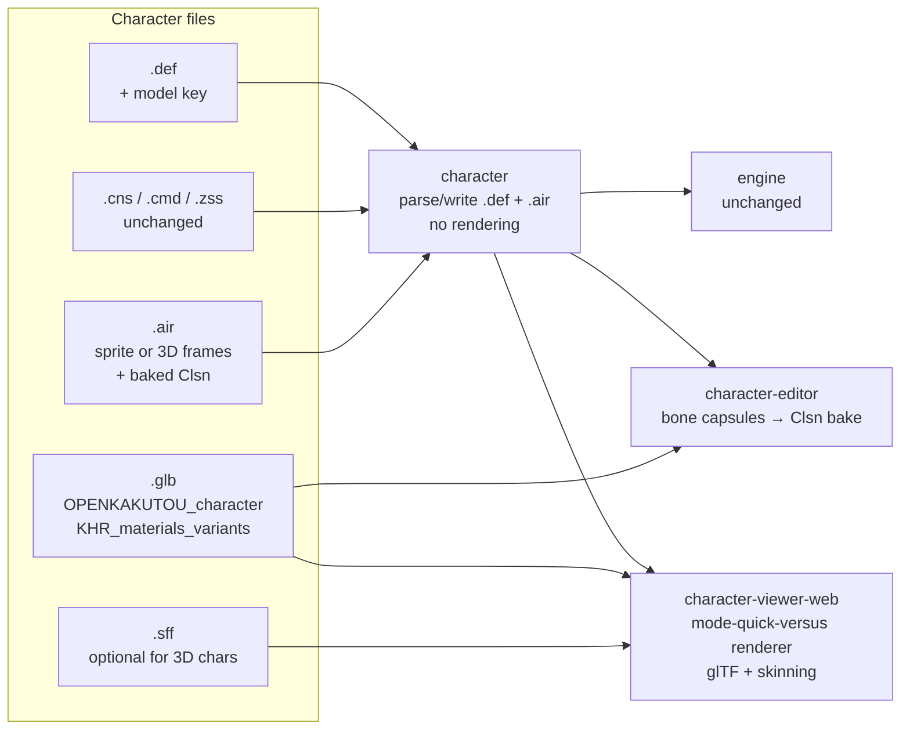

# OpenKakutou-exclusive 3D characters: extend the existing character format with a 3D presentation layer

**Context:** Decision `014` scoped Ikemen GO's 3D model-based stages and explicitly left 3D characters out, because Ikemen GO has no official 3D character support to be compatible with. The goal here is different: not compatibility with an existing engine, but an **OpenKakutou-exclusive** character format feature. A 3D character will not load in MUGEN or Ikemen GO, by design.

This does not conflict with the org-wide compatibility MUST (`repos.md`): that rule requires every MUGEN/Ikemen GO file to keep loading and behaving correctly in OpenKakutou. Adding an extension that only OpenKakutou understands leaves that untouched, as long as it is strictly additive.

A MUGEN/Ikemen character is already split in two:
- **Logic** — `.cns`/`.cmd`/`.zss`: states, commands, triggers, physics. It references visuals only through an action number (`ChangeAnim`, `ChangeAnim2`).
- **Presentation** — `.air` (per action: frames with a duration and `Clsn1`/`Clsn2` boxes, each frame pointing to a `(group, image)` sprite) and `.sff` (the sprites).

`engine` only consumes frame durations and Clsn boxes from `.air`; it never looks at the pixels.

**Decision:** Extend the existing format instead of inventing a separate one. Logic files are unchanged; only the presentation layer gains a 3D variant.

1. **`.def`** — `[Files]` gains a `model` key pointing to a glTF 2.0 binary (`.glb`), alongside the existing `anim` and `sprite` keys.
2. **`.air`** — a frame can reference either a sprite `(group, image)` (unchanged) or a 3D pose `(animation clip, time)`. Both kinds can coexist in one character and even one action, so sparks, `Explod`s and projectiles can stay sprite-based (from the character's `.sff`, or `fightfx.sff`) while the body is 3D. The exact line syntax is settled in `character`'s own implementation, against what MUGEN/Ikemen `.air` parsers already tolerate.
3. **Collision boxes are baked at authoring time, not computed at runtime.** In `character-editor`, collision volumes (capsules) are attached to the model's bones; the editor projects them onto the fight plane and writes the resulting `Clsn1`/`Clsn2` rectangles into `.air`, frame by frame. `.air` stays the single source of truth for hitboxes, and `engine` is unchanged and deterministic.
4. **Facing is a 180° rotation around the vertical axis, never a mirror.** A 3D character turning around shows its other side (a left-handed stance stays left-handed). Because Clsn boxes live on the fight plane (an orthographic projection), the projection of a model rotated 180° around the vertical axis is exactly the mirror of the unrotated projection: existing Clsn mirroring on `facing = -1` stays correct, with no per-facing bake.
5. **glTF vendor extension `OPENKAKUTOU_character`** carries model-level settings that have no glTF equivalent: model scale and ground origin relative to the character's axis, root bone. Exact schema settled in `character`'s implementation.
6. **Palettes map to `KHR_materials_variants`** (an existing, ratified glTF extension): each palette slot selects a material variant, so palette selection at character select works unchanged for 3D characters.
7. **Interoperability with sprite characters relies on the standard action numbers.** Custom states (`ChangeAnim2`, `p2stateno`) and `common1.cns` work unchanged: a 3D character must provide the standard actions (e.g. the 5000+ get-hit range) as 3D poses, exactly as a sprite character provides them as sprites. A 3D character can fight a sprite character and vice versa.

Repo split, mirroring decisions `012` and `014` (data vs. rendering):

- **`character`** parses/serializes the new `.def` key and the 3D `.air` frames as pure data. No glTF reading, no rendering — its existing constraint holds. It also owns the written specification of the extension (`.air` 3D frame syntax, `OPENKAKUTOU_character` schema, palette mapping), as the reference for the character format; the editor and renderers implement against it.
- **`character-editor`** owns the authoring side: binding capsules to bones and baking Clsn into `.air`.
- **`character-viewer-web`** and the `mode-quick-versus` renderer load the `.glb` and play skinned animation. Library choice (three.js on the web, a Go glTF loader on native) is left to each repo, as decision `014` did.
- **`engine`** gets no change: it still sees action numbers, durations and Clsn rectangles.

No new repository: glTF is read with standard libraries (as in decision `014`), skinned rendering is written per stack (web vs. native Go, nothing to share), and Clsn baking has a single consumer (`character-editor`).

This amends decision `014`'s *"`character` is explicitly out of scope"* line: it remains true for Ikemen GO compatibility, and is superseded for this OpenKakutou-only extension.

**Reason:** Logic (`.cns`/`.cmd`/`.zss`) is the costliest part of a character and is already supported end to end by `character`, `engine` and `character-editor`; reusing it lets 3D characters use `common1.cns` and the standard action numbers, which is what makes mixed 3D-vs-sprite matches work. Baking Clsn at authoring time keeps the simulation identical for both kinds of characters. glTF's own extension mechanism and `KHR_materials_variants` cover what's new without inventing a container format.

**Rejected alternatives:**
- *A brand-new, standalone 3D character format* — rejected: would re-specify states, commands and triggers already handled end to end, and would break interaction with sprite characters (custom states, standard get-hit actions).
- *Pre-render 3D models to `.sff` sprites* — rejected for this goal: needs no format change, but gives up what 3D brings (other side visible on turn, stage lighting, dynamic camera); remains possible as an independent tool.
- *Mirror on facing instead of rotation* — rejected: a mirrored 3D model swaps its handedness and shows the same side in both directions, which defeats the point of a 3D character.
- *Compute Clsn at runtime from bone-attached volumes* — rejected: would make `engine` depend on skinning math and floating-point pose evaluation, threatening determinism, and would split hitbox truth between `.air` and the model.
- *Store the whole character (logic included) inside the `.glb`* — rejected: logic files would no longer be editable/readable by the existing tooling, for no benefit.
