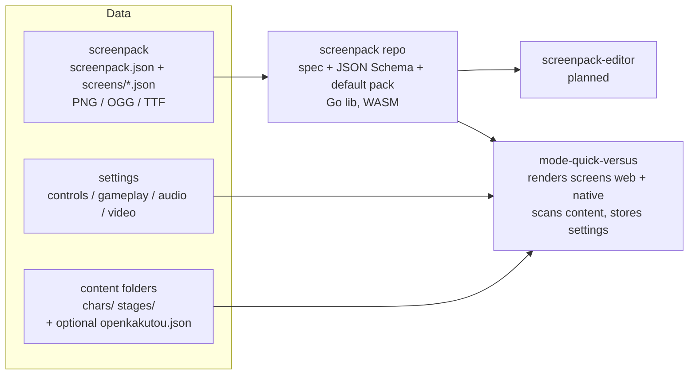

# An OpenKakutou screenpack format, split settings and automatic content discovery for the complete game

**Context:** Backlog `018`. `mode-quick-versus` plays a match end to end but is not a complete game: no title/main menu, no options, no configurable controls, a hand-written roster manifest (`mode-quick-versus/src/roster/manifest.ts`). In MUGEN/Ikemen GO this layer is a screenpack (`system.def` + `select.def`) plus a global engine config. The Product Owner wants the screenpack *concept* (themable screens, shareable by the community) but rejects three things in MUGEN/Ikemen's organization:
- the catch-all `system.def`, mixing every screen with hundreds of absolute-pixel positioning keys;
- the global engine config (`mugen.cfg` / Ikemen GO config) holding options and key bindings together;
- the hand-declared roster (`select.def`).

**Decision:**

**Compatibility scope.** MUGEN/Ikemen GO screenpacks, `select.def` and engine configuration files are **out of** the compatibility MUST: not read, not converted. The MUST still fully applies to combat content (characters, stages, lifebars, sprites, sounds, fonts used by that content). Reason: those files describe the *game shell*, which OpenKakutou designs itself; combat content is what the community shares and must keep working.

**1. Screenpack format (OpenKakutou-specific).**
- **Modular**: a root `screenpack.json` (name, author, version, format version, defaults such as base fonts and sounds) plus **one file per screen** under `screens/` (`title`, `select`, `vs`, `options`, `controls`, `pause`, `results`, extended as screens are added). A missing screen file falls back to the default screenpack's.
- **Syntax**: JSON, comments allowed (JSONC, for hand-modding), validated by a **published JSON Schema** per file — editors get completion and validation for free, unlike MUGEN's ad-hoc INI dialect.
- **Layout**: elements are placed by **anchor + offset in relative units** of the screen, adapting to resolution and aspect ratio — no absolute pixel coordinates.
- **Assets**: standard formats only — PNG/WebP images (sprite sheets described in JSON), OGG/Opus audio, TTF/OTF/WOFF2 fonts. No `.sff`/`.snd`/`.fnt` inside a screenpack. Character portraits and names on the select/VS screens come from the characters' own files (combat content), drawn by the game.
- **What a screenpack can change**: visuals, layout, element animations and transitions, text styles, sounds and music, order and visibility of the menu entries the game offers. **What it cannot**: add behavior — no scripting, no new menu actions. Game logic stays in code.
- **A default screenpack** ships with the game, written in this format, and serves as the reference example and the per-screen fallback.

**2. Repos.** A new **`screenpack`** repo (Go, compiled to WASM, no rendering dependency) holds the format specification, the JSON Schemas, the default screenpack, and a library that loads, validates (schemas + cross-file checks: referenced assets exist, screen ids known), resolves fallbacks and writes screenpacks. A library is justified, unlike lifebar (decision `009`), because consumers span two languages — `mode-quick-versus`'s native Go renderer and its TypeScript web build — and must agree on validation and fallback rules; one Go implementation imported natively and via WASM avoids two drifting implementations. **`screenpack-editor`** is planned (authoring with live preview, needs only the library and a renderer). **`screenpack-viewer-web`** stays an idea: the editor's preview and the game itself already show a screenpack; symmetry alone is not a reason for a repo (same argument as decision `009`).

**3. Rendering.** `mode-quick-versus` renders screens from the resolved screenpack in both builds (web canvas, native renderer), as it already does for matches. HTML/`web-ui-kit` components are not used for in-game screens, since a screenpack must look identical on both builds.

**4. Settings, split by concern, outside the screenpack.** Separate files per concern: `controls.json` (per-player keyboard/gamepad bindings), `gameplay.json` (difficulty, round time, life, rounds…), `audio.json` (volumes), `video.json` (resolution, fullscreen, vsync), plus the selected screenpack. Native: the OS user config directory (`os.UserConfigDir()/openkakutou/`); web: browser storage, one key per concern. A screenpack never contains settings; settings never contain theme data. `mode-quick-versus` 022 (rebindable controls) stays in that repo and writes `controls.json`.

**5. Automatic content discovery.** No central roster file. Native scans the installed content folders (`chars/`, `stages/` — layout unchanged, familiar to the community). The web build generates its manifest **at build time** by scanning the same folders — never hand-written. Display metadata comes from the content's own files (`.def` `[Info]`, portrait sprite); an optional per-content sidecar `openkakutou.json` in the content's folder can override display name, order or hidden state — never a central list.

**6. Where the complete game lives.** `mode-quick-versus` grows this layer itself; decision `006` is not revisited now, and is reconsidered when `mode-tag-battle` is scoped. What a future shell or second mode would reuse is already shared: the `screenpack` library and format.

**7. Order.** Independent of the combat-completeness milestone (`013`): different repos, no shared prerequisite. `mode-quick-versus` integration starts once `screenpack` has its first release; content discovery and settings can start right away.

**Font scoping (`016`).** Screenpacks use standard fonts, so `.fnt` support remains needed only for lifebars and characters (combat content); `016`'s consumer list drops screenpacks.

**Reason:** Keeps what the community values in screenpacks (shareable themes) while fixing the three rejected organizational problems: one file per screen instead of a catch-all, settings split from theme and from each other, content discovered instead of declared. Standard syntax and assets make authoring tools cheap. Excluding the shell from the compatibility MUST costs nothing to combat content compatibility.

**Rejected alternatives:**
- *Support MUGEN/Ikemen screenpacks natively, or as an alternative theme* — rejected by the Product Owner: reproduces the rejected organization and doubles the menu systems.
- *Converter from MUGEN screenpacks* — rejected: the absolute-pixel, catch-all model doesn't map cleanly onto an anchored, modular one; not worth the cost without demand.
- *TOML or YAML* — TOML gets unwieldy for nested element trees; YAML's implicit typing is error-prone for hand-modders. JSONC + JSON Schema has first-class support in Go, TypeScript and editors.
- *Allow `.sff`/`.snd`/`.fnt` assets in screenpacks* — rejected: standard formats are what theme authors' tools produce; MUGEN formats stay where compatibility requires them.
- *Scripting in screenpacks* — rejected for now: themes describe appearance, not behavior; can be revisited with a concrete need.
- *Parse the format separately in TypeScript and Go* — rejected: two implementations of validation and fallback rules would drift (see the library justification above).
- *In-game screens built with `web-ui-kit` HTML components* — rejected: would render differently from the native build.
