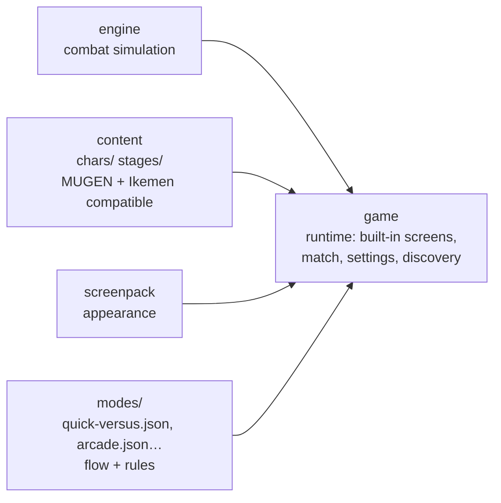

# One game runtime (`game`), game modes as data; supersedes decision `006`

**Context:** Decision `006` made each `mode-*` repo a complete, standalone game, deferring a multi-mode shell until a second mode exists. Decision `029` then put the whole complete-game layer (screens rendered from a screenpack, settings, content discovery) into `mode-quick-versus`. Looking at what `mode-quick-versus` actually contains, almost everything is mode-independent: match rendering, HUD, audio, input and gamepads, CPU opponent, native packaging, and now screens, settings and content discovery. What is specific to quick versus is small: a sequence of screens (two character selects → stage select → match setup → 1v1 match → results / rematch) and one rule set (one character per side). Under `006`, `mode-tag-battle` would have to rebuild all of the shared part, or extract it later at high cost. Ikemen GO reaches the same conclusion its own way: its game modes live outside the engine, in Lua scripts (`external/script/`).

**Decision:** The game is **three layers**:

| Layer | Nature | Where |
|---|---|---|
| **Game runtime** | Code | One repo, **`game`** (the current `mode-quick-versus`, renamed) |
| **Mode** | Data: a sequence of built-in screens + match rules | Mode definition files, built-in in `game` and installable |
| **Screenpack** | Data: appearance | Decision `029` format, `screenpack` repo |

- **`game`** is the playable game, web and native: match runtime (on top of `engine`), screen rendering from the screenpack, settings, content discovery, and a **library of built-in screen types** (title/main menu, character select, stage select, match setup, VS, match, results, continue, options, controls, pause…). The main menu lists the installed modes.
- **A mode is a definition file**, not a repo: its flow (which built-in screens, in which order, with which parameters — e.g. a select screen for 1 or N characters per side) and its match rules (players and characters per side, rounds, CPU opponents or ladder, win/lose conditions). Same syntax family as screenpacks (JSONC validated by a published JSON Schema). Modes have no scripting: a mode can only combine what the runtime offers. A mode needing a new mechanic (e.g. tag partner swaps) adds that capability to `engine` and/or `game` first, then is written as data.
- **Quick versus becomes the first mode definition**, shipped built-in with `game`. Further simple modes (arcade, survival, training, watch) are new definition files, not new repos.
- **Mode format home**: the specification, schema and loader live in `game` itself (Go package, imported by the native build and compiled to WASM for the web build) — `game` is its only consumer, so no separate library repo, unlike `screenpack` (decision `029`), which also has `screenpack-editor` as a consumer.
- **Modes and screenpacks stay independent**: any screenpack themes any mode; a screenpack must therefore style every built-in screen type, falling back to the default screenpack for any it omits (decision `029`). Decision `029`'s "no new menu actions in a screenpack" stands: menu entries come from installed modes and built-in screens, never from the screenpack.
- **Installable modes** are discovered like content (decision `029` §5): a `modes/` folder scanned natively, a build-time manifest on the web.

**Effect on earlier decisions:**
- **`006` is superseded**: modes are no longer repos, let alone standalone games.
- **`005`, `010`**: `mode-quick-versus`'s role carries over to `game`; its platform targets (desktop first, Android deferred per `027`, web) are unchanged.
- **`029`**: everything it assigns to `mode-quick-versus` now belongs to `game`; the "`006` is not revisited now" point (§6) is replaced by this decision.
- **`mode-tag-battle`** stops being a planned repo: it becomes a future mode definition, preceded by the `engine` and `game` capabilities it needs (roadmap backlog `015`, rescoped).
- The `mode-*` naming convention in `repos.md` is retired.

**Rename.** `openkakutou/mode-quick-versus` is renamed `openkakutou/game` (GitHub keeps redirects for the repo URL, not for GitHub Pages: `openkakutou.github.io/mode-quick-versus/` becomes `openkakutou.github.io/game/`). The Go module path, references in every repo's docs and code, the showcase site and the roadmap dashboard follow. Tracked as roadmap backlog `020`.

**Reason:** Puts the code where it is shared and makes a new mode cheap (a file, not a repo), while keeping appearance (screenpack) and behavior (runtime + mode) separate, so themes and modes combine freely. Decision `006`'s rejection of a shell as "premature, no second mode to learn from" no longer holds: the shared part is already known from building one complete mode, and decision `029` was about to grow it further inside a mode repo.

**Rejected alternatives:**
- *Keep `006`: one repo per mode* — rejected: every mode would duplicate the runtime, screens, settings and discovery, or force a later costly extraction.
- *Put the mode flow inside the screenpack* — rejected: ties behavior to a theme; changing theme would change which modes exist and how they play.
- *Modes as scripts (like Ikemen GO's Lua)* — rejected for now: declarative definitions over built-in screens cover the known modes (versus, arcade, survival, training, watch) and stay safe to install from the community; scripting can be revisited with a concrete mode it can't express.
- *A separate `mode` library repo for the mode format* — rejected: `game` is its only consumer.
- *Keep the name `mode-quick-versus`* — rejected: the repo now hosts every mode; the name would mislead.
- *Name the repo `kakutou` or `runtime`* — rejected by the Product Owner in favor of `game`: `kakutou` collides with the org and workspace name, `runtime` says little to players.
