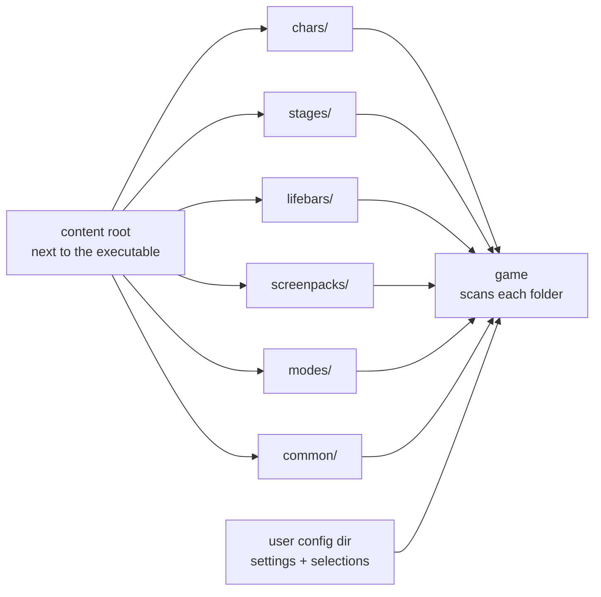

# Folder layout of an installed game: one folder per content kind, next to the executable

**Context:** Decisions `029` and `030` fixed `chars/`, `stages/` and `modes/`, and settings in the user config directory, but left four gaps: where lifebars live (in MUGEN they sit inside the screenpack's `data/`, yet `029` keeps lifebars in the compatibility MUST and screenpacks out of it), where screenpacks live, where the common combat files MUGEN characters need live (`common1.cns`, `fightfx.sff`/`.air`, `common.snd`), and where installed content lives. The Product Owner wants characters, stages, lifebars and screenpacks in distinct folders.

**Decision:**

```
OpenKakutou/                  content root, next to the executable (portable)
├── openkakutou(.exe)
├── chars/        characters as shipped by MUGEN/Ikemen GO, untouched   (029)
│   └── kfm/      kfm.def .air .cns .cmd .sff .snd [kfm.glb] [openkakutou.json]
├── stages/       stages untouched: flat files or one subfolder per stage (029)
├── lifebars/     one folder per lifebar, MUGEN/Ikemen format (fight.def + sff/snd/fnt)
│   └── default/
├── screenpacks/  one folder per screenpack, OpenKakutou format (029)
│   └── default/  screenpack.json  screens/*.json  images/ sounds/ fonts/
├── modes/        mode definitions: quick-versus.json, …              (030)
└── common/       common combat files: common1.cns(.zss), fightfx.sff/.air, common.snd

<user config dir>/openkakutou/  controls.json gameplay.json audio.json video.json  (029)
                                + selected screenpack and selected lifebar
```



1. **One folder per content kind**, each scanned like `chars/` (`029` §5): no central list.
2. **Lifebars are independent of screenpacks.** The lifebar shown in a match is its own setting, chosen like the screenpack; any lifebar works with any screenpack. A lifebar folder keeps the MUGEN/Ikemen GO format (compatibility MUST): a lifebar taken out of a MUGEN screenpack's `data/` is dropped into `lifebars/<name>/` as is.
3. **Common combat files live in `common/`**, as visible, replaceable files (the role of MUGEN's `data/`), shipped with the game.
4. **The content root is next to the executable** (portable, as MUGEN and Ikemen GO: unzip and play). On macOS it sits next to the application bundle, not inside it. Settings stay in the user config directory (`029` §4).
5. **Defaults are ordinary content on disk**: `screenpacks/default`, `lifebars/default`, `modes/quick-versus.json`. They double as examples to copy; the game treats them like any installed content.
6. The web build bundles the same tree and generates its manifest at build time (`029` §5).

**Reason:** Matches the Product Owner's wish for distinct folders; keeps community content droppable as is (MUST); separates appearance choices (screenpack, lifebar) as `029` separated settings by concern; a portable root is what the MUGEN community already knows.

**Rejected alternatives:**
- *Lifebar inside the screenpack, as in MUGEN* — rejected by the Product Owner (distinct folders), and it would mix a MUST-compatible format into a non-MUGEN one.
- *The screenpack names its lifebar* — rejected: couples two independent appearance choices.
- *Common combat files embedded in the executable* — rejected: nobody could adjust or replace them.
- *Content in the user data directory, or in both places* — rejected for now: less familiar to modders; two roots would need a duplicate rule.
- *Defaults embedded in the executable* — rejected: no visible example to copy.
