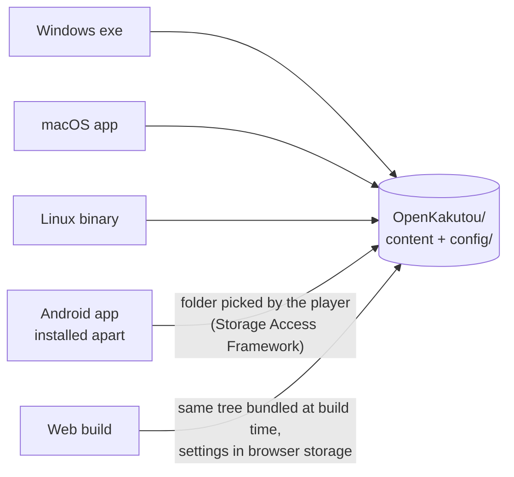

# The game folder is portable across Windows, macOS, Linux and Android

**Context:** Decisions `031` and `032` made the game folder self-contained (content + `config/`, next to the executable). The Product Owner wants that same folder to move unchanged between Windows, macOS, Linux and Android. An Android app is installed apart from its files and cannot read arbitrary folders; a desktop executable only runs on its own OS.

**Decision:** Amends `031` §4 and `032`.

```
OpenKakutou/                      the same folder on every platform
├── openkakutou.exe               Windows    ┐ desktop programs side by side:
├── OpenKakutou.app/              macOS      │ unzip, run the one for your OS
├── openkakutou                   Linux      ┘ (Android: app installed apart)
├── config/
│   ├── gameplay.json             shared by every device
│   ├── audio.json                shared
│   ├── appearance.json           shared (screenpack, lifebar)
│   ├── video.json                one section per platform
│   └── controls.json             one section per platform
├── chars/  stages/  lifebars/  screenpacks/  modes/  common/
```



1. **Desktop programs sit side by side at the root**: one zip holds the folder and the Windows, macOS and Linux programs; each runs from there and uses the folder it sits in. On macOS the `.app` sits in the folder, never the folder in the `.app`.
2. **Android**: the app is installed apart; on first launch the player picks the game folder (e.g. `Documents/OpenKakutou` or an SD card) through Android's folder picker (Storage Access Framework), and the app keeps that access. The folder survives uninstalling and is filled over USB or with a file manager. File access goes through an Android bridge (content URIs, not plain paths); scanning very large rosters is slower than on desktop.
3. **Device-specific settings have one section per platform** (`windows`, `macos`, `linux`, `android`, `web`) in `video.json` and `controls.json`; `gameplay.json`, `audio.json` and `appearance.json` are shared.
4. **Cross-platform file rules**, applied by every reader and writer: file names matched case-insensitively (MUGEN content comes from Windows; Linux and Android are case-sensitive), `\` accepted as a separator, no absolute paths in `config/` (everything relative to the folder), UTF-8 JSON, no symbolic links, and names the game writes itself valid on Windows, macOS, Linux and FAT/exFAT SD cards.
5. **Web** is unchanged (`029` §5, `032`): same tree bundled at build time, settings in browser storage.

**Reason:** Product Owner direction. A picked folder is the only Android option that is reachable by the player, survives uninstall and stays Play Store compliant; side-by-side programs keep the unzip-and-play habit of `031`; per-platform sections stop a PC resolution or keyboard mapping from being applied to a phone.

**Rejected alternatives:**
- *Android app-private folder* (`Android/data/…`) — erased on uninstall, unreachable from file managers since Android 11.
- *Android "all files access" permission* — plain paths, but effectively refused by the Play Store.
- *Data-only folder, programs installed elsewhere* — loses unzip-and-play.
- *All settings shared across devices* — a desktop resolution or keyboard mapping is meaningless on a phone.
