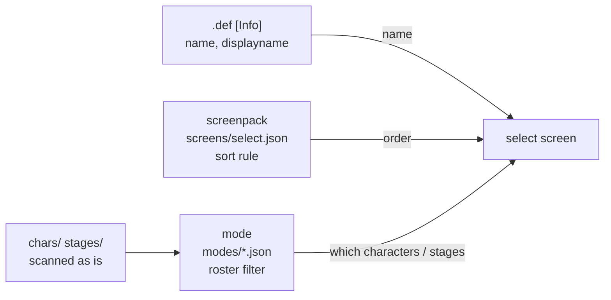

# No per-content sidecar: name from the `.def`, order from the screenpack, visibility from the mode

**Context:** Decision `029` §5 (and `031`'s tree) allowed an optional `openkakutou.json` in a character or stage folder to override display name, order and hidden state. The Product Owner rejects it: the name is fixed by editing the `.def`, and order or visibility describe how a screen or a mode presents the roster, not the character.

**Decision:** Amends `029` §5 and `031`: there is no `openkakutou.json` in content folders.

- **Name**: always from the content's own files (`.def` `[Info]`). To rename, edit the `.def`.
- **Order** belongs to the screenpack's select screens: a sort rule (by folder name, display name, author), not a list of names, since a theme cannot know which content is installed. Default: folder name, case-insensitive.
- **Visibility** belongs to the mode: a mode definition may filter the roster (include/exclude by folder name), e.g. a boss excluded from selection but used as an arcade opponent. Default: every discovered content is selectable.
- Content folders stay exactly as the community ships them (MUST unchanged).

**Reason:** Product Owner direction. Order is presentation (screenpack, appearance); which characters a game offers is a rule (mode, behavior) — consistent with `030`'s appearance/behavior split. No OpenKakutou file ever lives inside community content.

**Rejected alternatives:**
- *`openkakutou.json` sidecar* (`029` §5) — rejected: duplicates the `.def` name and puts presentation and rules on the character.
- *Explicit ordered list in the screenpack* — a theme is shared across installs with different content; a list would go stale. A sort rule does not.
- *Visibility in the screenpack* — `029` forbids behavior in screenpacks; which characters are selectable changes how a mode plays.
