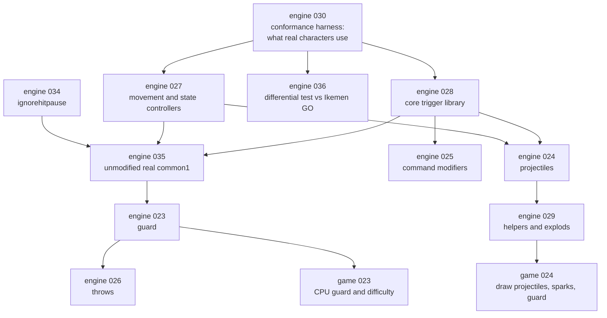

# Combat-completeness milestone: fidelity to MUGEN/Ikemen GO during a fight comes first

**Context:** Backlog `013`. Engine items (guard, projectiles, command modifiers, throws, movement controllers, triggers, helpers/explods, hit-pause controllers, common1) and `game` items 023-024 form one milestone. The Product Owner sets the first goal: a fight must behave as in MUGEN/Ikemen GO.

**Decision:**

1. **Priority.** This milestone comes before the complete-game items (screens, modes, menus: game 031-049): `vibe:next-task` treats the engine steps below as the hub's priority.
2. **Measure first, then build what real characters use, then prove it.**

   Order: 030 → 027, 028 → 034 → 035 → 023 → 025 → 024 → 029 → 026 → game 024 → game 023. Engine 036 runs alongside from 030 on and becomes the gate for every later step. Engine 031 (fuzzing) and 032 (CI) are outside the milestone and may run anytime. Engine 012 (registry dispatch) is revisited once 027/028 have added their controller and trigger types: the switch growth they bring is the evidence that item was waiting for.
3. **Acceptance characters:** Kung Fu Man as shipped with MUGEN 1.1 (`kfm`, `.cns`) and Ikemen GO's `kfm_zss` (`.zss`, from the Ikemen-GO-Screenpack repo), used as local fixtures, not redistributed; plus the real-character corpus already used by `character` for the harness's coverage report.
4. **"Good enough to ship v1 versus":** with both acceptance characters and an unmodified real common1, a full scripted match (walk, jump, attacks, guard, throws, projectiles, hit sparks, falls, round end) runs with zero unsupported controllers or triggers reported by the harness and no divergence from the Ikemen GO reference traces (036); the corpus coverage number is published, and its most-hit missing items are backlog items.

**Reason:** Product Owner direction (fidelity first). The harness and the differential traces turn "faithful" into something measured instead of claimed; common states come before guard and throws because every reaction (get hit, guard, fall) runs through them.

**Rejected alternatives:**
- *Features in the original numbering (022-026 first)* — builds guard and throws on controllers and triggers that real characters' common states do not yet run.
- *Complete-game screens first* — a polished shell around fights that do not behave like MUGEN contradicts the stated first goal.
- *MUGEN-only acceptance character* — the MUST covers Ikemen GO too, and `.zss` characters exercise a different execution path.
