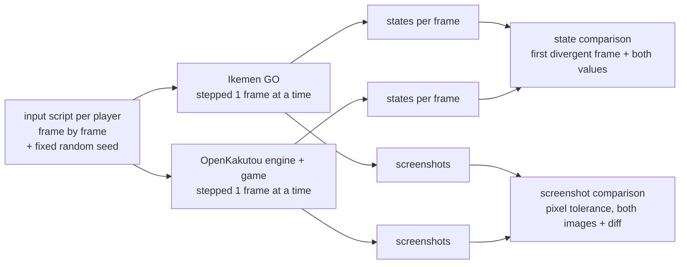

# Differential test protocol against Ikemen GO: replayed inputs, no CPU, states and screenshots

**Context:** Decision `038` makes Ikemen GO the verification reference and approves end-to-end differential tests. The Product Owner then settled how a whole match is compared.

**Decision:**

1. **Simulated inputs only, never the CPU.** Both sides are driven by a scripted or recorded input sequence per player. The CPU opponent is never used: its decisions are not the reference engine's and would cause divergences unrelated to compatibility.
2. **Deterministic replay.** Both engines are stepped one frame at a time, with no wall clock, and given the same random seed (characters use `Random` in their own states). Whether Ikemen GO accepts a fixed seed is the first thing engine#036 establishes.
3. **States and screenshots, on the same replay.**
   - States every frame: fighters (state, animation and element, position, velocity, life, power, hit/guard flags; engine#036), stage camera and layers including BGCtrl, lifebar values and elements (game#051). A failure names the first divergent frame and both values.
   - Screenshots at regular intervals and on key events (hit, round end), same internal resolution and scaling, filtering off, per-pixel tolerance. A failure keeps both images and their difference.
4. **Scope** (decision `038`): content that works in Ikemen GO; OpenKakutou-only content (3D characters, screenpacks, modes) is not compared.
5. Runs in CI on recorded input scripts, reference traces and reference screenshots.

**Reason:** States locate the cause of a combat divergence; screenshots catch rendering divergences (sprites, palettes, stage layers, lifebar, fonts) that states cannot. A CPU or an unseeded random source would produce failures that say nothing about compatibility.

**Rejected alternatives:** *Screenshots only* — a differing image does not tell combat from rendering. *States only* — rendering errors pass unnoticed. *Real-time replay* — drifts as soon as one frame is late. *CPU-driven matches* — two different AIs, not a compatibility test.
