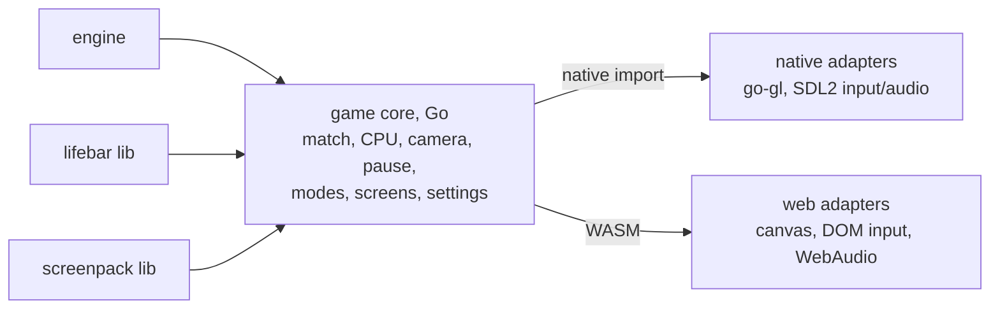

# `game`: one Go core shared by the web and native builds; only rendering, input and audio output stay per platform

**Context:** Decision `022` accepted "two UI implementations" per app. In `game` the duplication goes well beyond the UI: match flow, CPU opponent, camera, pause, roster, lifebar layout and audio logic exist both in TypeScript (`game/src/`, about 6,900 lines) and in Go (`game/native/internal/`, about 4,500 lines). Every fidelity fix outside `engine` must be made twice, and the differential test against Ikemen GO (`game` 051) only proves one of the two. The complete-game items (`game` 031–049: screens, modes, settings, discovery) would double the problem again. Decision `030` already put the mode loader in Go, compiled to WASM for the web build.

**Decision:**
- Everything in `game` that does not depend on the platform lives in **one Go core** inside `game` (native import + WASM for the web build): match flow, round/HUD state, CPU opponent, camera, pause, roster and content discovery rules, lifebar layout (through the `lifebar` library, decision `046`), mode flow, screen state machines, settings model.
- Per platform, only the **adapters** remain: drawing (canvas/WebGL vs go-gl), input devices, audio output, file access and storage.
- New complete-game work (`game` 031+) is built in the shared core only; no new feature is written twice.

**Reason:** One implementation to make faithful and to test against Ikemen GO; the differential test then covers both builds. Same argument decision `029` used for `screenpack`.

**Rejected alternatives:**
- *Keep two runtimes* — every parity fix twice, and the web build drifts unmeasured.
- *Compile the native renderer to WASM* — go-gl/SDL2 does not target WebGL; the drawing layer is the part that legitimately differs.
- *Wait for the architecture audit (roadmap `025`)* — every complete-game item built meanwhile raises the cost of the extraction.

**Effect:** `game` backlog `060`; prioritized by decision `048`.
